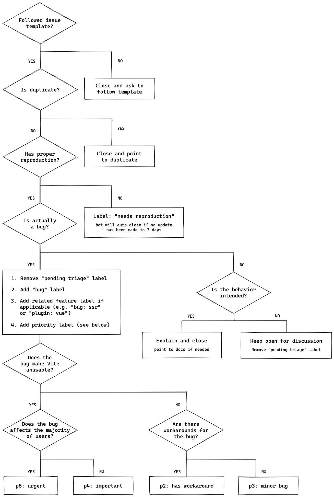

# Moasherat Contributing Guide

Before submitting your contribution, please make sure to read through the following guidelines:

- [Moasherat Contributing Guide](#moasherat-contributing-guide)

  - [Issue Reporting Guidelines](#issue-reporting-guidelines)
  - [Pull Request Guidelines](#pull-request-guidelines)
  - [Development Setup](#development-setup)
  - [Git Hooks](#git-hooks)

    - [Committing Changes](#committing-changes)
    - [Commonly used NPM scripts](#commonly-used-npm-scripts)

  - [Project Structure](#project-structure)
  - [Maintainers](#maintainers)

## Issue Reporting Guidelines

- Always follow this workflow when reporting a new issue:



Your issue report should include:

- **Clear and descriptive title** to identify the problem.
- **Detailed steps to reproduce the problem**, explaining how you executed commands and which environment variables were set.
- **Specific examples** demonstrating the issue, e.g., a live example on [CodeSandbox](https://codesandbox.io/).
- **Observed behavior** and **expected behavior**, highlighting what went wrong and what should have happened.

## Pull Request Guidelines

- Work in **dedicated branches**, not the `main` branch.
- Create topic branches off of `dev` and merge back into it.
- Work in the `src` folder; **do not commit `dist` files**.
- It's OK to make multiple small commits; GitHub will automatically squash them.
- Ensure that `pnpm test:unit --run` passes before submitting a PR.

For adding new features or bug fixes:

- If adding a feature, provide test cases in `test/unit/specs/`.
- If fixing a bug, include a detailed description and add appropriate test coverage.

## Development Setup

Ensure you have:

- [Node.js](http://nodejs.org) **version 16+**
- [pnpm](https://pnpm.io/) for package management

After cloning the repo, run:

```bash
pnpm install # install project dependencies
```

We use the following tools:

- **Nuxt.js** for frontend development
- **Vite** and **ESBuild** for bundling
- **Vitest** for unit testing
- **Prettier** for code formatting
- **ESLint** for static error prevention

## Git Hooks

The project uses [husky](https://typicode.github.io/husky/) for the following:

- Type-checking the project
- Auto-formatting code with Prettier
- Validating commit message format

### Committing Changes

Commit messages should follow the [commit message convention](./commit-convention.md) to enable automatic changelog generation.

### Commonly Used NPM Scripts

```bash
# watch and auto re-build for Nuxt.js
$ pnpm dev

# build the project
$ pnpm build

# run unit tests with coverage
$ pnpm test:unit --coverage

# run linting checks
$ pnpm lint
```

For full testing, the script runs linting, type-checking, unit tests, and e2e tests. Ensure all tests pass locally before submitting a PR.

## Project Structure

You can find the detailed project structure in: [Project Structure](./project-structure.md)

## Maintainers

You can find the list of maintainers in: [Maintainers](./maintenance.md)

---

Let me know if you'd like further modifications!
